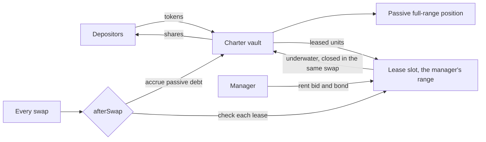

# Charter

**Managers rent your liquidity. You are owed what passive would have earned, plus rent.**

Charter is a Uniswap v4 hook that turns active liquidity management into a lease. Depositor capital sits in a real full-range position by default. A manager who wants to run some of it bids rent, posts a bond and takes a slice of that capital to place wherever they like in the same pool. Whatever the market does, the manager owes depositors what that capital would have earned had it stayed passive, plus the rent they bid. The hook checks every lease inside every swap and closes any that can no longer pay, in that same swap.

Depositors get the passive return without having to judge who is skilled. Managers get capital without having to raise it, and keep everything they earn above the benchmark. The bond, not the depositor, carries the manager's risk.

| | |
| --- | --- |
| Theme | UHI-11, Active Management and Curated Liquidity |
| Network | Unichain Sepolia, hook [`0x47c2652A9AD7704A7eDbe8A276F213b59e51e0C0`](https://sepolia.uniscan.xyz/address/0x47c2652A9AD7704A7eDbe8A276F213b59e51e0C0), verified |
| Contracts | One hook plus four delegatecall libraries, every one under the 24 KB limit |
| Tests | 130 tests, including 5 invariants, 7 attack scenarios and a twin-pool benchmark; 98.6% line coverage |
| Frontend | Next.js app wired to the live contracts, with read-only and fork-based browser tests ([`frontend/`](frontend/)) |
| Evidence | A study of four real mainnet vaults that sets the design ([`analysis/`](analysis/)) |

---

## Why

We measured four managed liquidity vaults on mainnet Uniswap v3 USDC/WETH over about a year and a half each, sampled daily from archive state ([`analysis/`](analysis/)). Each is compared with a passive full-range position in the same pool.

| Vault | Return vs passive | Market-making skill vs passive |
| --- | --- | --- |
| Charm Alpha Vault | -12.7% | -2.5% |
| G-UNI (Arrakis V1) | -14.4% | -1.2% |
| `0x381e` | -14.1% | -2.4% |
| `0x5763` | +12.5% | -1.6% |

Three findings shaped Charter:

1. **Depositors lost to a risk they never chose.** In three of the four vaults, depositors ended 12.7 to 14.4 points behind a passive LP, in a falling market and in a rising one. The fourth was ahead only because it ended up holding mostly USDC through a crash.
2. **The losses were not about market-making skill.** Fees minus loss-versus-rebalancing, with the ETH price taken out, was within 2.5 points of passive for all four. The damage came from the price exposure created by the shape of the range.
3. **Skill cannot be measured reliably enough to pay on.** Scored hourly over the same 60 days, two vaults were both about +0.2% against passive. Scored weekly, the sign flips. A fee or a firing rule tied to measured performance pays for luck.

So Charter does not try to measure managers. It transfers the risk to them. A manager who takes a range takes its price exposure, its inventory risk and its gains, and owes depositors a benchmark set by full-range capital, which their choice of range cannot shrink.

### The open problem this answers

Charter applies the idea behind the auction-managed AMM ([Adams, Moallemi, Reynolds and Robinson, 2024](https://arxiv.org/abs/2403.03367)) to concentrated liquidity. In am-AMM, an onchain auction sells the right to manage a constant-product pool, and the manager pays rent to LPs. The paper's closing section ([page 13 of v4](https://arxiv.org/pdf/2403.03367v4)) leaves extending the design

> "particularly to concentrated liquidity AMMs, in which different liquidity providers may have different returns during the same period and may go in or out of range as a result of price changes"

as "left for future work."

Charter's answer is to stop asking what the manager's liquidity earned and instead fix what every depositor is owed: the full-range passive return, which is the same for everyone. The manager's concentrated position can go in and out of range freely, because what is owed is defined by full-range capital, not by where the manager puts it.

---

## How it works



**Depositors** call `deposit` and receive Charter LP shares, an ERC-20 claim on a slice of everything the vault owns. That covers the passive position, every leased unit owed back, unpaid fee debt and rent due. `withdraw` pays out that slice. If the passive position is too small to pay a withdrawal, the hook recalls capital from the lease paying the least rent.

**Managers** call `openLease` on an empty slot. Each lease, up to four at once, sets how many units it takes, a rent rate per year and a bond in token1, and the manager chooses any range. The hook moves those units out of the passive position, converts them and places the manager's position. From then on the lease owes three things:

- **The units themselves**, valued at full range at the current price. This is what the capital would be worth had it never moved.
- **The fees those units would have earned at full range**, tracked per unit by a passive fee accumulator that the hook updates in every swap.
- **Rent**, accruing every second on the units' value, charged from the bond.

The manager keeps everything the range earns beyond that. They can `rebalance` to a new range, `topUpBond`, or `exitLease`, which settles the books and returns any surplus to them.

**Anyone** can take over a slot. `bid` offers higher rent and escrows a new bond. After a five-minute delay, anyone can call `activate` in a block where the price has barely moved, which settles the incumbent and opens the new lease. Rent is set by competition between managers, not by governance.

### Inside every swap

`beforeSwap` records the block's opening price on the block's first swap, snapshots the pool's fee growth in transient storage, and pins the fee at 0.30%.

`afterSwap` does two things.

1. **It accrues what passive capital earned in this swap.** If the vault's capital all sat at full range, its share of the fee is known exactly. Once some of it is leased, the manager's concentrated liquidity takes fee share from everyone in the pool, so the hook prices the counterfactual: the fee those units would have earned had the leased capital stayed at full range. That is the debt.
2. **It checks every lease.** If a lease's held value, plus its bond, less its unpaid rent, falls below what it owes plus a 1% margin, the hook closes it before the swap returns. The close only removes liquidity, never swaps, and settles at the clamped price. Any surplus goes to the manager as ERC-6909 claims and any shortfall comes from the bond. Anything the bond cannot cover is recorded on chain as `uncovered`, not hidden.

A full check of every lease on every swap would be expensive, so each healthy check arms a **guard**. The lease's spare equity is split into a tick band, a time horizon and a fee budget, sized so the lease stays healthy while all three hold. While they do, a swap only compares the price, the clock and the fee counters against the guard. Leaving any of them forces a full check, which re-arms the guard. A fuzz test confirms that anywhere inside the band, `liquidate` reverts with `Healthy`.

---

## The hard parts

### What does "passive" mean when the manager is in the same pool?

This is where a naive design breaks. If the debt were simply the pool's real fee growth per unit of full-range liquidity, a manager could concentrate tightly around the price. That takes fee share from the passive position and shrinks the very benchmark they owe. The manager would be paying their debt with the depositors' own diluted fees.

Charter prices the counterfactual instead. Each swap's LP fee is divided over the liquidity that would have been there had the managed liquidity stayed full range: everyone else, plus all the depositors' units. Managed liquidity that was in range during the swap is weighted by how much of the swap's price path its range covered.

The exact counterfactual depends on how traders would have behaved in a different pool, so no onchain number can be exact. What we can do is bound it. [`test/Twin.t.sol`](test/Twin.t.sol) runs identical swaps through the Charter pool and a hookless twin where the capital really stayed passive, with arbitrage pulling both to the same outside price.

| Manager's share of active liquidity | Flow | Pool's real passive fees (floor) vs truth | Charter's debt (ceiling) vs truth |
| --- | --- | --- | --- |
| 2.1% | retail | -1.86% | +0.11% |
| 2.1% | balanced | -1.18% | +1.56% |
| 2.1% | arbitrage | -0.08% | +2.99% |
| 7.9% | balanced | -3.57% | +5.89% |
| 24.7% | balanced | -10.32% | +22.57% |

The figures are errors in the fee part of the debt only; the principal owed is exact. Using the pool's real fees would undercharge the manager, and the shortfall would come out of depositors. Charter's estimate errs the other way: at a 2.1% share it charged the manager between 0.11% and 2.99% more fee than the truth, and in none of these runs less. The error grows with the manager's share, so Charter **caps managed liquidity at 5% of the pool's active liquidity**, counting every lease as in range. A fuzz test over 64 random flows and lease sizes checks the bracket holds: the pool's real fees never exceed the truth by more than 1%, and the estimate never falls short of it by more than 3%.

### Liquidating inside a swap, with no oracle

The only price Charter trusts is the pool's own, and the pool's price can be pushed within a block. Two rules make a push unprofitable:

- **Settlement uses a clamped price.** Rent, withdrawals and liquidations are valued at spot, clamped so that its square root stays within 1% of the block's opening value, about 2% in price. A push can trip a liquidation, but it can move what the bond pays by no more than the clamp.
- **Debt is valued at the same clamped price as the holdings.** An early version took the debt's token mix at spot, which let a push inflate the debt and move bond to depositors. Testing caught it before deployment.

Six attack tests in [`test/Attacks.t.sol`](test/Attacks.t.sol) judge each attack by the attacker's own profit at a fixed reference price, and every one loses:

| Attack | Result |
| --- | --- |
| Manager wash-trades through their own range to farm fees | Loses: the fees paid go to other LPs and into the debt |
| Large depositor pushes the price to force a liquidation, then pushes back | Loses: settlement is clamped, so the push costs more than any bond it moves |
| Manager pushes the price so their capital looks cheaper when rent is charged | Saving stays under 3% of the rent, and the push costs more |
| Depositor pushes the price before withdrawing while a lease owes fee debt | Worse off than withdrawing honestly |
| Outsider sandwiches a manager's rebalance | Depositors keep what they are owed; the sandwich loses |
| Price games around a deposit while leases are open | Attacker loses; existing depositors are not diluted |

A seventh, sandwiching a forced liquidation, lives in [`test/Liquidation.t.sol`](test/Liquidation.t.sol) and also loses.

### Exact rent

Rent accrues every second on the leased units' value and is collected lazily, whenever a lease is touched. Lazy collection usually leaks to rounding: early versions let a manager erase rent entirely by touching the lease every block, then overcharged by 8% after the first fix. Charter carries an exact remainder (`rentCarry`, in value × rate × seconds), so collecting every block equals collecting once, to within one wei. A test checks exactly that.

### An auction that cannot be gamed cheaply

A bid must beat both the current rent and any pending bid by 5% of their rate, which stops one-wei griefing. The bond is escrowed, and an outbid bidder is refunded at once. Activation waits five minutes, and must happen in a block where the price has barely moved, so a takeover cannot be timed against a push. At activation the hook re-checks the bid against whoever holds the slot now. A pre-deploy review caught a bug here: a stale 6% bid placed against a 5% lease could displace a newer 10% lease. The fix and its regression test are in [`test/Auction.t.sol`](test/Auction.t.sol). A dust swap in every block cannot stall activation either.

### Deposits and withdrawals while capital is out

Shares price everything the vault owns, including receivables. Before any deposit or withdrawal, every lease's rent is collected and its fee debt paid from what it holds, which leaves the manager's equity unchanged. A withdrawal is paid by value from idle tokens and passive liquidity. If passive is short, the hook first recalls capital, in a block where the price has barely moved: it shrinks or closes the lease paying the least rent and settles the slice at exactly what those units owe. The manager's equity is unchanged by a recall.

### Fitting under 24 KB

The hook owns every position, so the flows had to run in its context. They live in four external libraries called by delegatecall: `VaultLogic`, `LeaseLogic`, `RiskLogic` and `ViewLogic`. The hook stays the only owner and the only caller the PoolManager sees, and the frontend reads a single address.

| Contract | Runtime size |
| --- | --- |
| `Charter` (hook and LP token) | 20,260 B |
| `LeaseLogic` | 16,503 B |
| `RiskLogic` | 7,527 B |
| `ViewLogic` | 6,324 B |
| `VaultLogic` | 5,894 B |

---

## Gas

Measured by [`test/Gas.t.sol`](test/Gas.t.sol) through the test router, with every contract and library the swap touches cooled first, as in a fresh transaction. The figures exclude the 21,000 base cost. The hookless pool has the same tokens, fee and liquidity.

| Pool state | Swap gas | Over a hookless pool |
| --- | --- | --- |
| No hook | 73,171 | |
| Charter, no leases | 96,226 | +23,055 |
| Charter, 1 lease, guard holding | 143,194 | +70,023 |
| 2 leases, guards holding | 155,049 | +81,878 |
| 3 leases, guards holding | 166,904 | +93,733 |
| 4 leases, guards holding | 178,950 | +105,779 |
| 1 lease, full check | 204,923 | |
| 4 leases, full check | 426,193 | |

The guarded path is the normal one: each extra lease adds about 12,000 gas. A full check happens when a lease's guard expires, after at most a day, or when price or fees leave its budget, and it re-arms the guard for the swaps that follow. With no leases open, Charter adds about 23,000 gas to a swap.

---

## Security and testing

```bash
forge test                                  # 130 tests
forge test --match-path test/Gas.t.sol -vv  # the gas table above
forge test --match-path test/Twin.t.sol -vv # the twin-pool table above
forge coverage --ir-minimum --report summary --no-match-coverage "(^test|^script|^lib/)"
```

- **Invariants** ([`test/invariant/`](test/invariant/)): four actors take 13 kinds of action, including targeted bids at occupied slots, 128 calls deep. After every call, five properties must hold:
  1. the PoolManager claims the hook holds equal its books
  2. vault totals equal the sum over leases
  3. every Uniswap position's liquidity equals what the books say
  4. share supply adds up
  5. **no swap ever reverts**

  The hook runs inside every swap, so a revert would freeze the pool. That is the property we care about most.
- **Attacks:** the seven above, each judged by the attacker's profit.
- **Twin pool:** the passive benchmark against a real counterfactual, plus a fuzz test of the bracket.
- **Guard soundness:** a fuzz test that a lease inside its armed band is never liquidatable.
- **Regressions:** the bugs found in review have tests that fail on the old code.
- **Coverage:** 98.6% of lines, 96.7% of statements, 99.2% of functions and 76.3% of branches across `src/`.
- **Static analysis:** Slither raised nothing beyond what the review had already found and fixed.

Identity never comes from a hook callback's `sender`, which inside a hook is the router, not the user. Deposits, leases and bids all go through Charter's own entry points, which use `msg.sender`, and depositor payouts go to the address the caller names.

---

## Hook permissions

| Callback | Why |
| --- | --- |
| `beforeInitialize` | Binds the hook to the one pool it was configured for, and rejects any other pool or a second initialization. |
| `beforeSwap` | Records the block's opening price, snapshots the pool's fee growth in transient storage, and returns the 0.30% fee as an override, so the fee the hook prices debt with is exactly the fee the pool charged. |
| `afterSwap` | Accrues the passive benchmark, then checks every lease and liquidates any that is underwater, in the same swap. |

No callback changes a swap's amounts. A trader pays exactly what they would pay in a plain 0.30% pool.

## Parameters

| Parameter | Value | Why |
| --- | --- | --- |
| Lease slots | 4 | Each guarded lease adds about 12,000 gas per swap |
| Minimum bond | 5% of the leased value | First-loss capital ahead of depositors. A bigger bond widens the guard band and survives bigger moves; a single gap swap can still exceed it (see limits) |
| Maintenance margin | 1% of what is owed | Closes a lease while it still has equity, so the gap between spot and the settlement price is paid from the bond |
| Settlement clamp | 1% of the square-root price, about 2% in price | Bounds what a same-block push can do to any valuation |
| Share cap | 5% of active liquidity | Keeps the passive estimate within a few percent of the truth (see the twin-pool table) |
| Minimum raise | 5% of the higher rate | Stops one-wei bid griefing |
| Takeover delay | 5 minutes | Gives the incumbent time to respond and stops timing a takeover against a push |
| Pool fee | 0.30% | |

---

## Live on Unichain Sepolia

All contracts are verified on [Uniscan](https://sepolia.uniscan.xyz). The pool is tWETH / tUSDC with a 0.30% fee and 60-tick spacing, opened at 3,000 tUSDC per tWETH. Both tokens are open-mint test tokens deployed for this pool.

| Contract | Address |
| --- | --- |
| Charter hook and LP token | [`0x47c2652A9AD7704A7eDbe8A276F213b59e51e0C0`](https://sepolia.uniscan.xyz/address/0x47c2652A9AD7704A7eDbe8A276F213b59e51e0C0) |
| tWETH (currency0, 18 decimals) | [`0x54A2CbC2947E3Ec15F1B8eDc3A25D61d070ae668`](https://sepolia.uniscan.xyz/address/0x54A2CbC2947E3Ec15F1B8eDc3A25D61d070ae668) |
| tUSDC (currency1, 6 decimals) | [`0xd508662f90226b081E749CB699658A7034721E0c`](https://sepolia.uniscan.xyz/address/0xd508662f90226b081E749CB699658A7034721E0c) |
| PoolSwapTest router | [`0xD873f0eb417d26d862963884CC0fC301938Ab2a9`](https://sepolia.uniscan.xyz/address/0xD873f0eb417d26d862963884CC0fC301938Ab2a9) |
| PoolModifyLiquidityTest router | [`0x82c079e598bb0fEbb59777FdCBd5030EE97409DF`](https://sepolia.uniscan.xyz/address/0x82c079e598bb0fEbb59777FdCBd5030EE97409DF) |
| Uniswap v4 PoolManager | [`0x00B036B58a818B1BC34d502D3fE730Db729e62AC`](https://sepolia.uniscan.xyz/address/0x00B036B58a818B1BC34d502D3fE730Db729e62AC) |

Pool ID: `0x19bc8b1b1392beb47d523abcd4db7f9e4ee097c862833bd2c8996f3bb9f4ffa7`

At deployment, [`script/Seed.s.sol`](script/Seed.s.sol) set up the following:
- outside liquidity
- a deposit of about $329,000 in test tokens
- one lease of a third of that capital at 5% rent, with twice the minimum bond
- six swaps
- a competing 6% bid on the same slot

### Use the app

The frontend in [`frontend/`](frontend/) runs against these contracts. Connect a browser wallet with a little Unichain Sepolia ETH for gas, then mint test tokens from the footer. From there you can deposit, open a lease, bid, activate a takeover, rebalance, top up a bond or exit, and watch every number update from the chain. See [`frontend/README.md`](frontend/README.md).

### Move the price yourself

The test pool uses mock tokens and a dynamic-fee key, so Uniswap's interface does not route to it. From a clone of this repo, one command trades the pool to any price, given in tUSDC per tWETH. It mints whatever input the trade needs and prints each lease before and after:

```bash
forge script script/Move.s.sol --sig "run(uint256)" 3400 \
  --rpc-url https://unichain-sepolia-rpc.publicnode.com --broadcast --account <keystore> --sender <address>
```

A big jump in one block settles at the clamped price, so step the price over a few blocks to watch a lease fail the way it would in a real market.

Without the repo, trade through the deployed `PoolSwapTest` router directly. Selling 2 tWETH, which pushes the price down:

```bash
RPC=https://unichain-sepolia-rpc.publicnode.com
TWETH=0x54A2CbC2947E3Ec15F1B8eDc3A25D61d070ae668
TUSDC=0xd508662f90226b081E749CB699658A7034721E0c
HOOK=0x47c2652A9AD7704A7eDbe8A276F213b59e51e0C0
ROUTER=0xD873f0eb417d26d862963884CC0fC301938Ab2a9

cast send $TWETH "mint(address,uint256)" <your address> 10ether --rpc-url $RPC --account <keystore>
cast send $TWETH "approve(address,uint256)" $ROUTER $(cast max-uint) --rpc-url $RPC --account <keystore>
cast send $ROUTER \
  "swap((address,address,uint24,int24,address),(bool,int256,uint160),(bool,bool),bytes)" \
  "($TWETH,$TUSDC,8388608,60,$HOOK)" "(true,-2000000000000000000,4295128740)" "(false,false)" 0x \
  --rpc-url $RPC --account <keystore>
```

To push the price up, mint and approve tUSDC instead and send `(false,<negative tUSDC amount>,1461446703485210103287273052203988822378723970341)`. The hook runs inside each of these swaps. It accrues the passive debt and re-checks every lease, and if one is liquidated, the app's logbook shows it within seconds.

### Deploy your own

```bash
forge script script/Deploy.s.sol --rpc-url <rpc> --broadcast --account <keystore> --sender <address>
forge script script/Seed.s.sol   --rpc-url <rpc> --broadcast --account <keystore> --sender <address>
```

Without `POOL_MANAGER` set, `Deploy.s.sol` also deploys a fresh PoolManager, which is how it runs on a local anvil chain. Both scripts write and read `deployments/<chainId>.json`.

---

## Honest limits

- **Rent depends on managers having an edge.** The study found market-making skill close to passive for all four vaults. If no manager can beat the benchmark, nobody bids, and Charter is simply a passive full-range vault. Depositors lose nothing against passive by finding out. Charter is the safe way to learn whether a manager is worth paying, not a promise that one is.
- **One swap can outrun the bond.** A single swap far past a lease's range can leave a shortfall bigger than its bond. The hook records it as `uncovered` and depositors share it. A test shows it happening rather than pretending it cannot. The bond and the 1% margin absorb ordinary moves; how often a gap outruns them depends on the manager's range and on the market.
- **The passive benchmark is an estimate.** It sits within a few percent of the truth on the fee part, at the capped share, and leans toward the depositor.
- **The share cap is checked when a lease is placed, rebalanced or taken over,** not as other LPs come and go. If outside liquidity leaves, a lease can end up above 5% until its next change.
- **Settlement trusts the block's opening price.** Within a block, valuations are clamped to it. Across blocks, Charter trusts the pool's price like any onchain LP position does, and has no external oracle.
- **No native ETH.** The pool uses ERC-20 tokens; a WETH wrapper would be a small addition.
- **A static-fee pool would work too.** Nothing in the design needs a dynamic fee; the hook only needs to know the fee. A static-fee deployment would be a small change to the pool key and the bind check.
- **Partner integrations:** none. Charter is built on Uniswap v4 and deployed on Unichain only.

## Prior art

| Design | How it differs |
| --- | --- |
| Managed vaults (Charm, Arrakis and others) | Depositors carry the manager's price exposure, and any fee is paid whatever the result. The study above measures what that cost. |
| am-AMM hooks (Maestro, AuctionPool, Turnstile and others) | Auction the right to manage the pool and pay LPs rent. In Maestro the manager even re-concentrates the liquidity, but the LPs still carry whatever that range does. Charter's manager carries it, against a debt set by passive capital. |
| Bonded-manager hooks (Touchstone, UHI-10) | The manager is billed from a bond when a move loses money against an outside market price, and depositors keep the market risk. Charter needs no outside price, and the manager takes on the market risk of their own range. |
| Scored curators (Proving Ground, UHI-7) | A curator's shadow strategy is scored to decide how much capital they may manage. Our study found such scores can flip sign with how often they are sampled, so Charter charges managers instead of scoring them. |
| Tranche hooks (STRATUM, Unistrata, TrancheGuard and others) | A junior tranche absorbs losses passively. Charter's first-loss capital is the bond of the party choosing the risk. |
| Leveraged LP hooks (BoostLP, ybAMM and others) | LPs borrow tokens to enlarge their own position, so the debt is in tokens. Charter's managers owe an LP-indexed benchmark, so depositors keep exposure to the pool's real return. |

We searched all 765 entries in the Atrium hook directory, as listed in November 2026 and including this cohort's, by name and description, and read the full description of every close match. We did not find one in which a manager runs depositor capital and owes depositors the passive LP return. The closest are in the table above.

## Repository

| Path | Contents |
| --- | --- |
| [`src/Charter.sol`](src/Charter.sol) | The hook: entry points, callbacks, passive accrual and views |
| [`src/libraries/`](src/libraries/) | `VaultLogic`, `LeaseLogic`, `RiskLogic`, `ViewLogic` (external), plus the math libraries |
| [`src/types/CharterTypes.sol`](src/types/CharterTypes.sol) | The vault's book, leases, guards and bids |
| [`test/`](test/) | Unit, fuzz, twin-pool, attack, gas and invariant suites |
| [`script/`](script/) | Deploy, seed, and move the price |
| [`deployments/1301.json`](deployments/1301.json) | Unichain Sepolia addresses |
| [`analysis/`](analysis/) | The mainnet vault study, in Python with only the standard library |
| [`frontend/`](frontend/) | The app |

Built with Foundry (solc 0.8.26, via-IR), Uniswap v4-core, v4-periphery and OpenZeppelin's uniswap-hooks.
